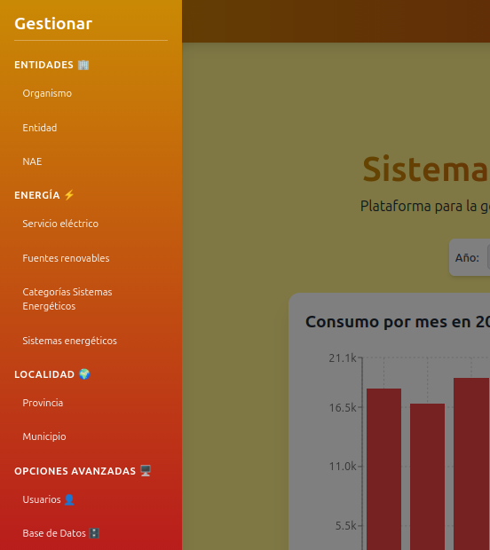
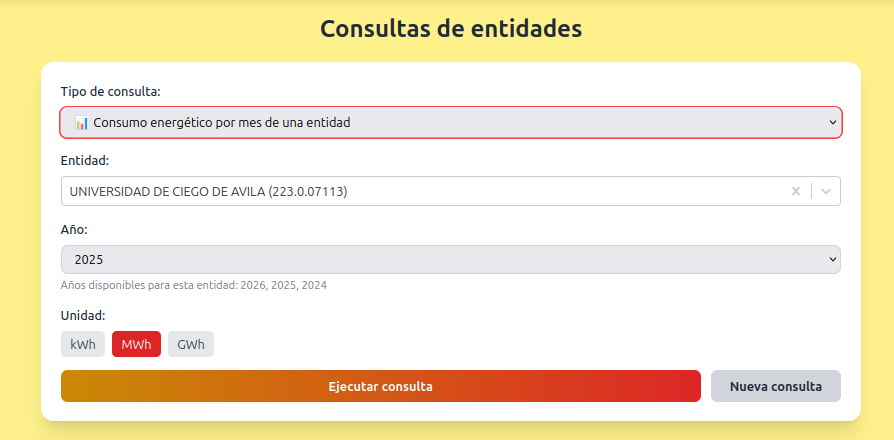
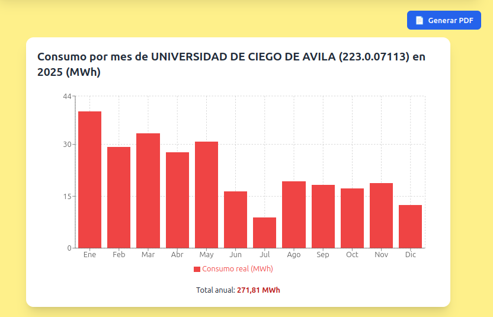
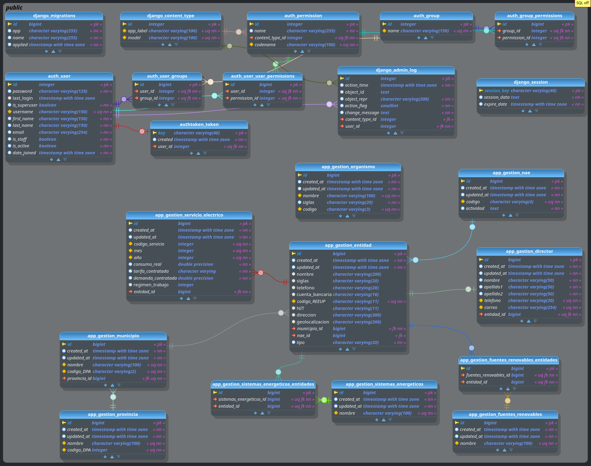
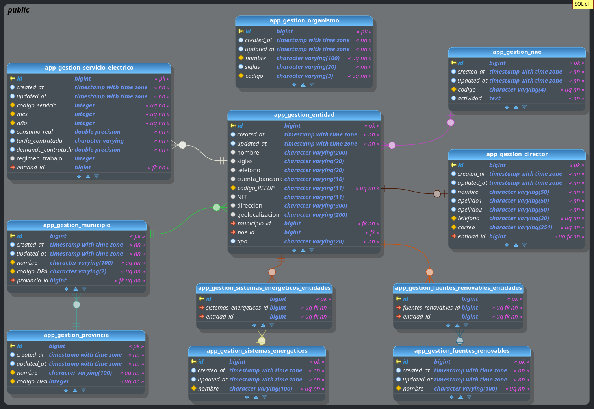

# ⚡ Sistema de Gestión Energética

Aplicación web para la gestión de la información relacionada con el uso racional de la energía eléctrica en la provincia Ciego de Ávila. Desarrollada con Django REST Framework y React, facilita la administración de entidades y servicios eléctricos.

## 🚀 Características principales

- Autenticación de usuarios con tokens. 
- Gestión completa de entidades, organismos, servicios eléctricos, provincias y municipios.
- Generación de reportes y gráficos de consumo.
- Diseño responsive con Tailwind CSS.


## 🛠️ Tecnologías utilizadas

### Backend


### Frontend


### Base de Datos


### Despliegue
- Render (backend y frontend)
- Supabase (base de datos)


### 📁 Estructura del proyecto (backend)

```
app_gestion/
├── models/               # Modelos organizados por archivo
│   ├── base.py           # TimeStampedModel abstracto
│   ├── organismo.py, entidad.py, municipio.py, servicio_electrico.py, ...
├── serializers/          # Serializadores DRF
├── views/                # ViewSets y vistas de autenticación
├── urls/                 # Configuración de rutas (auth, api, consultas)
└── admin.py              # Registro en el administrador de Django
```


### 🖼️ Imágenes de la aplicación

**Login**


<br>

**Inicio**


<br>

**Perfil de usuario**


<br>

**Sidebar**



<br>

**Gestionar entidades**


<br>

**Crear entidad**


<br>

**Editar entidad**


<br>

**Eliminar entidad**


<br>

**Gestionar servicios eléctricos**


<br>

**Importar archivo Excel de servicios eléctricos**


<br>

**Importando servicios eléctricos**


<br>


**Consultas**


<br>


<br>


<br>


<br>


**Modelo lógico de la aplicación**


<br>



